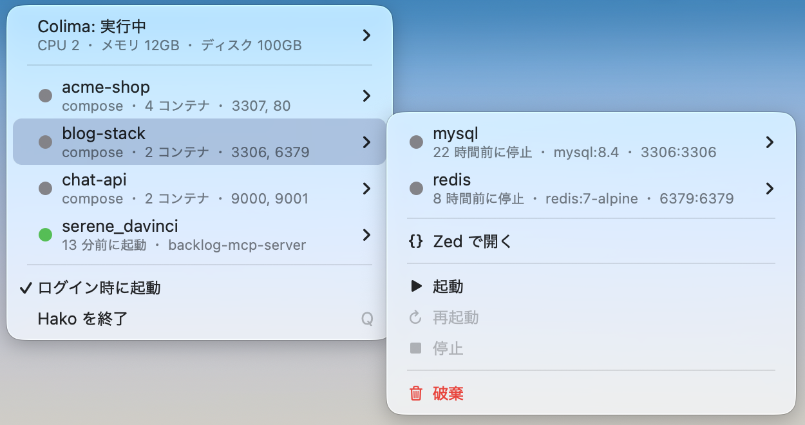

# Hako

macOS のメニューバーに常駐し、[Colima](https://github.com/abiosoft/colima) とコンテナの状態を表示・操作する小さなアプリ。



## 機能

### ステータス表示

- メニューバーアイコンで Colima の状態がひと目で分かる
  - 実行中: 塗りつぶし / 停止中: アウトライン / 操作中: 丸付き
  - 稼働中なのにポート公開すべきコンテナが落ちている場合はオレンジ色
- コンテナ一覧
  - compose はプロジェクト単位でグループ化し、状態を●で色分け(緑: 稼働 / オレンジ: 一部停止 / グレー: 全停止)
  - 各行に稼働状況(「4分前に起動」)・イメージ・ポート(`ホスト:コンテナ`)を表示
  - ポートなしの exited コンテナ(cli / init 系)はノイズになるので非表示
- Colima のバージョンと VM の割り当て(CPU/メモリ/ディスク)、コンテナごとの CPU/メモリ使用量(docker stats)
- ディスク使用量の内訳(イメージ / コンテナ / ボリューム / ビルドキャッシュ、`docker system df`)
- メニューを開いている間は 3 秒間隔でライブ更新

### メインウィンドウ

- メニューの「Hako を開く…」から表示（⌘0）
- サイドバーとメイン領域を分け、ヘッダーにタイトル・検索・アイコン操作を集約
- macOS 26以降はLiquid Glassを使用。それ以前は標準マテリアルとボタンで表示
- 名前・状態・CPU・メモリ・イメージを標準テーブルで表示（プロジェクト選択時はサービス名で表示）
- 名前・状態・CPU・メモリ・イメージの列見出しで並べ替え。CPU・メモリは数値順に並び、停止中のコンテナは昇順・降順とも末尾に表示
- ダブルクリックまたは⌥⌘Iで、幅を調整できる詳細インスペクタを表示
- サイドバー右上のボタンで開閉（⌥⌘S）。更新は「Compose プロジェクト」の見出し横から操作
- メイン側のボタングループからリソース整理とインスペクタを表示
- Colima停止中はサイドバーの一覧を隠し、メイン領域に案内と起動ボタンを表示
- 名前・イメージ・サービス・プロジェクト名で検索（⌘Fで検索欄へ）
- Compose プロジェクトの起動・停止・再起動を、右上のアイコンボタンで直接操作（ツールチップと読み上げラベル付き）
- コンテナの操作、ログ・ターミナル・エディタへのアクセス
- 表示中は3秒間隔で状態とCPU・メモリ使用量を更新（⌘Rで手動更新）
- ウィンドウのサイズ・位置を保存。閉じてもメニューバーに常駐
- ウィンドウ表示中はDockとアプリ切り替えにも表示

### キーボードショートカット

| 操作 | キー |
|---|---|
| メインウィンドウを開く | ⌘0 |
| すべてのコンテナ | ⌘1 |
| 単体のコンテナ | ⌘2 |
| コンテナを検索 | ⌘F |
| 状態を更新 | ⌘R |
| サイドバーを開閉 | ⌥⌘S |
| インスペクタを開閉 | ⌥⌘I |
| 起動 | ⌃⌘↑ |
| 停止 | ⌃⌘↓ |
| 再起動 | ⌃⌘R |

起動・停止・再起動は選択したコンテナが対象です。コンテナが未選択の場合は、サイドバーで選択したComposeプロジェクト全体が対象になります。

### 操作

- Colima の起動・再起動・停止
- compose プロジェクトの起動(`up -d`)・再起動・停止・破棄(`down`、確認あり)
- コンテナ単体の起動・再起動・停止・破棄(`rm -f`、確認あり)
- 公開ポートをブラウザで開く(⌥ で URL コピーに切り替え)
- ターミナルで接続(`docker exec`、bash/sh 自動判別)・ログ表示(`docker logs -f`)
- compose プロジェクトをエディタで開く(Zed / VS Code / Cursor など、「設定」でインストール済みのエディタから選択)
- 「ディスク使用量 > 未使用リソースを整理…」で、未使用イメージとビルドキャッシュを個別選択して削除
  - 半透明の整理ウィンドウで、候補・容量・選択状態を一覧表示
  - 停止中を含むコンテナが参照するイメージは候補から除外
  - タグなしイメージと、削除可能なすべてのビルドキャッシュを初期選択
  - 対象容量・候補理由・確認ダイアログ・処理結果を表示(共有データのため容量は目安)
  - キャッシュは現在のDockerコンテキストに対応する標準Buildxビルダーが対象。取得に失敗した場合は理由を表示し、イメージのみ整理可能
  - Macの空き容量への反映に必要なColima側の容量回収は別途実施
- 未使用の匿名ボリュームの一括削除(確認あり。保存データは復元できません)

### 常駐まわり

- ポート公開コンテナが勝手に停止 / unhealthy になったら macOS 通知
  (自分の操作による変化と Colima 自体の起動停止は通知しない)
- スリープ復帰時に即リフレッシュ
- ログイン時に自動起動のトグル(.app バンドルで起動しているときのみ)
- Hako / Colima の新しいバージョンが公開されたらメニューに知らせを表示(1 日 1 回確認)

## 必要なもの

- macOS 14.4+
- `colima` / `docker`(Homebrew でインストールされていること)

## インストール

```sh
brew install --cask nemooon/tap/hako
xattr -dr com.apple.quarantine /Applications/Hako.app
```

Apple Developer ID 署名なしのため、macOS が quarantine 属性を付けて起動を
ブロックします。上の `xattr` で属性を外してから起動してください。
または、一度起動を試したあと「システム設定 → プライバシーとセキュリティ」の
セキュリティ欄で「このまま開く」を選びます。

## ソースから実行

ビルドには macOS 27 SDK を含む Xcode 27 / Command Line Tools が必要です。
実行環境は引き続き macOS 14.4 以降に対応しています。

```sh
swift run --build-system native
```

SwiftBuild が SDK バージョンを 14.4 と記録する環境があるため、現在は `native` ビルドシステムを指定します。Liquid Glass の標準外観は macOS 26 以降で適用されます。

## .app としてビルド

```sh
./scripts/bundle.sh
open dist   # "Hako.app" をアプリケーションフォルダへ
```

ログイン時の自動起動は、メニュー下部の「設定 > ログイン時に起動」から設定できます。

## リリース

1. `scripts/bundle.sh` の `VERSION` を上げてコミット・push
2. `./scripts/release.sh <リリースノートのファイル>` — ビルド → zip → GitHub リリースを作成
   (ファイルを省略すると `gh` がエディタを開きます)
3. リリース公開をトリガーに `.github/workflows/bump-cask.yml` が動き、
   [nemooon/homebrew-tap](https://github.com/nemooon/homebrew-tap) の
   `Casks/hako.rb` の version と sha256 を自動更新します

ワークフローには tap へ push できる PAT を `TAP_GITHUB_TOKEN` として
リポジトリシークレットに登録しておく必要があります。

## 補足

- `docker compose down` したプロジェクトはコンテナが残っていないため一覧に出ません(`stop` なら出ます)
- compose のポート情報は、停止中でも `docker inspect` の設定値から補完しています

## ライセンス

[MIT](LICENSE)

## クレジット

このアプリは [Claude Code](https://claude.com/claude-code)(Claude Fable 5)とのペアプログラミングで作られました。
